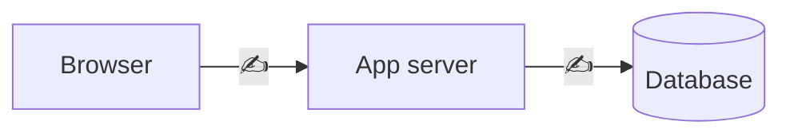

# ARCHITECTURE.md — <Your product name>

> **Template — every "✍️" is a decision you make and defend in the viva.** For each decision write:
> what you chose, *why* (one or two lines), and one alternative you rejected and why.
> After faculty sign-off, every change goes in the Decision log at the bottom.

**Author:** <your name> · **Version:** 1 · **Signed off:** <date / faculty>

---

## 1. Stack

| Layer | Choice | Why | Rejected alternative + reason |
|---|---|---|---|
| Framework | ✍️ | ✍️ | ✍️ |
| Hosting | ✍️ | | |
| Database | ✍️ | | |
| How the app talks to the DB (supabase-js server-side? direct Postgres?) | ✍️ | | |
| Auth | ✍️ | | |
| Email | ✍️ (note free-tier delivery limits) | | |
| AI model + library | ✍️ (record free-tier limits you checked, and the date) | | |
| Validation | ✍️ | | |
| Testing | ✍️ | | |
| File storage for medical certificates | ✍️ | | |

## 2. System diagram

Draw boxes for Browser, App server, Database, Auth provider, Email service, AI model API.
Label every arrow with what flows along it. **Mark with 🔒 every place a role check happens.**
Show clearly that the AI model only talks to your server, never to the DB.



## 3. Data model

Start from the brief's suggested tables (page 13). For each change (rename, split, add, drop) write why.
Questions you must answer here:
- Why are statutory and bank details in separate tables? ✍️
- Is "available balance" stored or calculated? What goes wrong if it's stored? ✍️
- Is day status stored or calculated? What happens to a stored status when leave is approved later? ✍️
- What stops two attendance rows for one employee on one date? ✍️
- How is a reporting loop (A→B→A) blocked — app code, DB, or both? ✍️
- How are holidays tied to locations, including national holidays that apply to both? ✍️
- How does a regularisation request work when there's no attendance row for that day? ✍️
- Where do the agent's drafts and logs live? ✍️

### ER diagram
```mermaid
erDiagram
  %% ✍️ add every table, key and relationship, e.g.
  %% locations ||--o{ employees : "works at"
```

### Constraints
| Table | Constraint | Type (PK / FK / UNIQUE / CHECK / trigger) | Rule it enforces |
|---|---|---|---|
| ✍️ | | | |

## 4. Access control

- How a signed-in user maps to an `employees` row: ✍️
- How "HR Admin" and "Manager" are determined: ✍️
- What happens to an exited employee who signs in: ✍️
- Where role checks run (pages, actions, routes, agent tools): ✍️

| Table | RLS on? | Rule | Why |
|---|---|---|---|
| employee_statutory | ✍️ | | |
| employee_bank | ✍️ | | |
| ✍️ | | | |

How URL tampering (opening another employee's profile by ID) is blocked: ✍️
How HR "Reveal" works and is logged: ✍️

## 5. Where business logic lives

| Rule | Location (DB function / server code / both) | Why |
|---|---|---|
| Working-day count | ✍️ | |
| Leave balance (opening, accrued, used, pending, available) | ✍️ | |
| Day status (Present / Half Day / Absent / On Leave / Holiday / Weekly Off) | ✍️ | |
| Late → LOP conversion | ✍️ | |
| Validation of Indian fields | ✍️ | |

How you guarantee the calendar, team view, CSV and agent all compute days the same way: ✍️

## 6. AI agent

- Model and library: ✍️
- System prompt contents (who the user is, today's date in IST, location, may/may not, "always use a tool for numbers"): ✍️
- What the model can see: ✍️ · What it can never see: ✍️
- How drafts are confirmed: ✍️
- How the 5-call limit is enforced and where logging happens: ✍️
- How you stop the model stating a number it didn't get from a tool: ✍️

| Tool | Inputs | Output | Who can use | Read / Write | Service function it calls |
|---|---|---|---|---|---|
| get_my_leave_balance | ✍️ | | Everyone | Read | |
| get_holidays | | | Everyone | Read | |
| count_working_days | | | Everyone | Read | |
| explain_policy | | | Everyone | Read | |
| draft_leave_request | | | Everyone | Write (confirmed) | |
| get_team_today | | | Managers | Read | |
| summarise_pending_approvals | | | Managers | Read | |
| ✍️ your extra tool | | | | | |

## 7. Folder structure
```
✍️ organised by module: employees, attendance, leave, reports, agent
```

## 8. Dates and time zone
How IST is enforced at each layer: DB column types ✍️ · server ✍️ · screen ✍️ · CSV ✍️
How you'll test it (e.g. running tests with a different TZ): ✍️

## 9. Risks

| # | What's most likely to break | Why | How you'll test it |
|---|---|---|---|
| 1 | ✍️ | | |
| 2 | ✍️ | | |
| 3 | ✍️ | | |

## 10. Decision log

| Date | Change | Reason | Sections updated |
|---|---|---|---|
| | | | |
