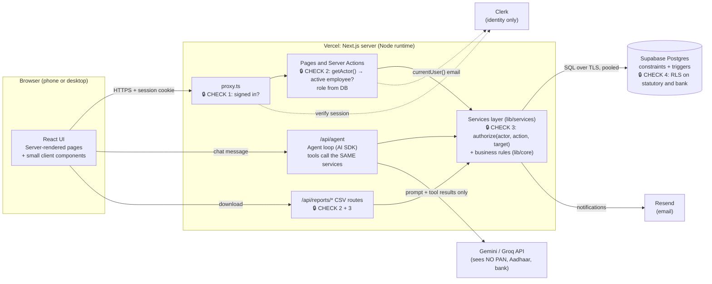

# ARCHITECTURE.md: Lehar HR (Konkan Coastal Foods HRMS)

> **Author:** Nandini Halarnkar · Every decision below can be traced to a policy rule in `RESEARCH.md` Part B (D/T/L codes)
> and to the code rule IDs in `docs/RULES.md` (e.g. `R-LV-04` = rule L10).
> If the build ever departs from this document, this file and the **Decision log** (§12) are updated first.

---

## 1. Stack

| Layer | Choice | Why | Alternative rejected, and why |
|---|---|---|---|
| Framework | **Next.js 16 (App Router, TypeScript)** | Server Components plus Server Actions put every role check on the server by default. One codebase covers UI, API and agent endpoint. Same framework as my ATS/PMS builds | *Express + React SPA*: two deployables, and role checks would rely on API discipline; more to secure |
| Hosting | **Vercel (Hobby, free)** | Zero-config Next.js deploys, preview URLs, environment variables per environment | *Render free*: the service sleeps after inactivity, so cold starts would hurt the live demo |
| Database | **Supabase Postgres (free)** | Real Postgres: unique, check, foreign-key and **exclusion constraints**, transactions, row-level security, `timestamptz` | *Firebase / Firestore*: no relational constraints or transactions across documents, so "one attendance row per day" and "no overlapping leave" would live only in app code |
| DB driver | **postgres.js** over the Supabase pooler (`prepare: false`) | Plain SQL with parameters, real transactions (`BEGIN … FOR UPDATE`) for approvals; the same SQL runs in tests against local Postgres | *supabase-js*: no multi-statement transactions from the client library; approval would need RPC functions for everything |
| Auth | **Clerk (free dev instance)** | Hosted sign-in (email code / password), sessions, `auth()` on the server. **Roles are not stored in Clerk** (brief) | *Supabase Auth*: fine, but Clerk was the course default and its `+clerk_test` emails make test logins trivial for graders |
| Email | **Resend (free, 3,000/month, 100/day)** via its REST API | One `fetch`, no SDK; every email is also written to `email_log` so the demo works even if delivery fails | *Nodemailer + Gmail SMTP*: app passwords, and Gmail blocks bulk sending from serverless IPs |
| AI | **Vercel AI SDK v5** with **Google Gemini** (`gemini-flash-latest`, free tier); **Groq** `llama-3.3-70b-versatile` as a switchable fallback | The AI SDK gives provider-neutral tool calling (`tool()`, `inputSchema`, `stopWhen`). Gemini Flash has a generous free-tier tokens-per-minute budget; Groq is the backup if Gemini rate-limits on demo day | *OpenAI API*: no free tier |
| Styling | **Tailwind CSS v4** + hand-built components (`components/ui`) | Small, accessible, and matches DESIGN.md tokens exactly | *A full component kit*: more weight than 13 screens need |
| Tests | **Node's built-in test runner via `tsx --test`** | Zero extra dependencies; runs pure rule tests and DB integration tests | *Vitest/Jest*: fine but unnecessary |

---

## 2. System diagram



**Where role checks happen** (defence in depth):
1. `proxy.ts`: no session means redirect to sign-in (Clerk).
2. `lib/auth/actor.ts` `getActor()`: maps the Clerk user to an `employees` row by email, reads `is_hr_admin`, derives *manager*, and **blocks exited employees** (`R-EMP-13`). Every page, action, route and agent call starts here.
3. `lib/services/*`: every service function takes the `actor` and calls `authorize…()` against the **target record** (e.g. "is this leave request's employee a direct report of the actor?"). Hiding buttons is cosmetic; this is the real check.
4. Postgres RLS: statutory and bank reads run as role `authenticated` with the actor's email in the JWT-claims setting, so even a bug in check 3 cannot read another person's PAN or account.

---

## 3. Data model

Changes from the suggested model are marked ✱ and justified in §3.2.

```mermaid
erDiagram
  locations ||--o{ employees : "works at"
  locations ||--o{ holidays : has
  departments ||--o{ employees : contains
  employees ||--o{ employees : "reports to"
  employees ||--|| employee_statutory : "1:1"
  employees ||--|| employee_bank : "1:1"
  employees ||--o{ attendance : punches
  employees ||--o{ regularisation_requests : raises
  employees ||--o{ leave_balances : holds
  leave_types ||--o{ leave_balances : "per type"
  employees ||--o{ leave_requests : applies
  leave_types ||--o{ leave_requests : "of type"
  leave_requests ||--o| leave_attachments : "certificate"
  employees ||--o{ audit_log : "subject / actor"
  employees ||--o{ agent_log : asks
  employees ||--o{ agent_drafts : owns
  employees ||--o{ email_log : receives

  locations { smallint id PK; text code UK; text name; text city; text state; smallint_arr weekly_off_days }
  departments { smallint id PK; text name UK }
  employees { uuid id PK; text employee_code UK; text clerk_user_id UK; text email UK; text full_name; text mobile; date dob; text gender; date date_of_joining; date last_working_day; text designation; smallint department_id FK; smallint location_id FK; uuid reporting_manager_id FK; text salary_grade; bool is_hr_admin; text address_fields; text emergency_fields }
  employee_statutory { uuid employee_id PK,FK; text pan UK; text aadhaar; text aadhaar_last4; text uan UK }
  employee_bank { uuid employee_id PK,FK; text account_number; text account_last4; text ifsc; text bank_name; text account_holder_name }
  holidays { int id PK; smallint location_id FK; date date; text name; text type }
  attendance { uuid id PK; uuid employee_id FK; date date; timestamptz check_in; timestamptz check_out; bool is_wfh; bool is_late; text source }
  regularisation_requests { uuid id PK; uuid employee_id FK; date date; timestamptz requested_in; timestamptz requested_out; text reason; text status; uuid requested_by FK; uuid approver_id FK; text approver_comment }
  leave_types { smallint id PK; text code UK; text name; numeric annual_quota; text accrual_method; numeric carry_forward_max; bool half_day_allowed; bool requires_balance; bool counts_calendar_days; text eligible_gender; numeric cert_required_after_days; numeric per_event_days }
  leave_balances { uuid id PK; uuid employee_id FK; smallint leave_type_id FK; int year; numeric opening; numeric adjustment }
  leave_requests { uuid id PK; uuid employee_id FK; smallint leave_type_id FK; date from_date; date to_date; bool is_half_day; numeric days; numeric paid_days; numeric lop_days; text reason; text status; uuid approver_id FK; text approver_comment }
  leave_attachments { uuid id PK; uuid leave_request_id FK,UK; text file_name; text mime_type; int size_bytes; bytea data }
  audit_log { bigint id PK; text table_name; text record_id; uuid subject_employee_id FK; text action; text field; text old_value; text new_value; text reason; uuid changed_by FK; timestamptz changed_at }
  agent_log { bigint id PK; uuid employee_id FK; text tool; jsonb inputs; jsonb result; bool ok; timestamptz created_at }
  agent_drafts { uuid id PK; uuid employee_id FK; text kind; jsonb payload; text status; text result_ref }
  email_log { bigint id PK; text to_email; text subject; text status; text error }
  policy_documents { smallint id PK; text slug UK; text title; text body }
```

### 3.1 Constraints (enforced in the database, not only in the UI)

| Rule | Constraint |
|---|---|
| Employee code unique and immutable (`R-EMP-08`) | `employee_code UNIQUE DEFAULT 'KCF'‖lpad(nextval(seq),4,'0')` + trigger `trg_employee_code_immutable` |
| Employees never deleted (`R-EMP-13`) | trigger `trg_employees_no_delete` raises on `DELETE` |
| 18+ on joining (`R-EMP-07`) | `CHECK (dob <= date_of_joining - interval '18 years')` |
| No self-manager or cycles (`R-EMP-09`) | `CHECK (reporting_manager_id <> id)` + trigger `trg_no_reporting_cycle` (recursive CTE up the chain) |
| PAN, Aadhaar, UAN, IFSC, mobile, PIN formats (`R-EMP-01…06`) | `CHECK (pan ~ '^[A-Z]{5}[0-9]{4}[A-Z]$')`, etc. The same regexes as `lib/core/validation.ts` |
| One attendance row per employee per day (`R-ATT-03`) | `UNIQUE (employee_id, date)`; check-in uses `INSERT … ON CONFLICT DO NOTHING` |
| Check-out after check-in | `CHECK (check_out IS NULL OR check_out > check_in)` |
| One holiday per location per date | `UNIQUE (location_id, date)` |
| No overlapping active leave (`R-LV-10`) | `EXCLUDE USING gist (employee_id WITH =, daterange(from_date,to_date,'[]') WITH &&) WHERE (status IN ('PENDING','APPROVED'))` |
| Half day only on single date (`R-LV-05`) | `CHECK (NOT is_half_day OR from_date = to_date)` |
| Paid + LOP = total days (`R-LV-07`) | `CHECK (paid_days + lop_days = days)` |
| One balance row per employee, type and year | `UNIQUE (employee_id, leave_type_id, year)` |
| Certificate ≤ 2 MB (`R-LV-08`) | `CHECK (size_bytes <= 2097152)` |

### 3.2 Changes from the suggested data model (justified)

| ✱ Change | Why |
|---|---|
| `employees.status` **removed**; "active" is derived from `last_working_day` | A stored status and a date can disagree. "Cannot log in after the last working day" must flip at midnight IST with no cron job, so it is calculated as `last_working_day IS NULL OR last_working_day >= today_ist` |
| `employee_statutory.aadhaar_last4`, `employee_bank.account_last4` (generated columns) | Screens and CSVs select **only** `*_last4`. The full Aadhaar column is never selected by any query after insert, which you can check with `grep -rn "aadhaar" lib/` |
| `leave_balances` stores **only** `opening` and `adjustment`; *accrued, used, pending, available* are **calculated** | Answer to "store or calculate?": a stored `available` drifts the moment an approval, cancellation or policy edit forgets to update it. Calculating from approved requests makes "balance changes only on approval" (`R-LV-12`) and "cancel restores balance" (`R-LV-13`) automatic |
| `leave_requests.paid_days`, `lop_days` | One request can be partly paid and partly LOP (`R-LV-07`); the month-end CSV needs both |
| `leave_attachments` table (bytea) instead of `attachment_url` | No extra storage bucket or policy to configure. Certificates are small (≤ 2 MB); about 180 employees fit easily in the 500 MB free database. Downloads go through a route that checks the same approver rules |
| `regularisation_requests` keyed by `(employee_id, date)` instead of `attendance_id` | A missed punch often has **no** attendance row yet, so there is nothing to point at. Approval upserts the row |
| `regularisation_requests.requested_by` | A manager may raise a request for a direct report ("Request only" in the role matrix); HR then approves it |
| `leave_types.requires_balance`, `counts_calendar_days`, `eligible_gender`, `cert_required_after_days`, `per_event_days` | Make Maternity, Paternity and LOP configurable data, not `if (code === 'ML')` branches |
| `audit_log.action`, `reason`, `subject_employee_id` | One table records field changes, **Reveal** clicks (`R-EMP-11`), deactivations and HR attendance corrections (`R-ATT-08`) |
| `agent_drafts` (new) | Drafts written by the agent (a leave request, an HR reminder email) wait here until a human clicks **Confirm** |
| `email_log` (new) | Proof that the notification was sent (or why not), visible to HR |
| `policy_documents` (new) | The **only** text `explain_policy` may answer from. HR can edit it in Settings |

**Why statutory and bank details live in separate tables:** RLS works per row, not per column. If PAN sat on `employees`, any policy letting a manager read a direct report's name would also expose their PAN. Separate 1:1 tables get their own strict policy: only the owner or HR may read them. They also make "never `SELECT *` on sensitive data" obvious in code review.

**What stops two attendance rows for the same day?** `UNIQUE (employee_id, date)` in the database, plus `ON CONFLICT DO NOTHING` in the check-in query. A double click, two tabs or a retry all end up with one row (`R-ATT-03`).

---

## 4. Access control

### 4.1 Signed-in user → employee → role
1. Clerk signs the user in. `getActor()` reads the Clerk user's **primary email**.
2. It looks up `employees` by `clerk_user_id`. On the first login it finds the row by `lower(email)` and stores the `clerk_user_id` (checkpoint 5).
3. No matching row → `/access-denied?reason=no-record`. Exited (`last_working_day < today IST`) → `/access-denied?reason=exited`.
4. **Role** is calculated, never stored in Clerk:
   - `isHrAdmin = employees.is_hr_admin` (the only stored role flag)
   - `isManager = EXISTS (active employee WHERE reporting_manager_id = me)`
   - Everyone is an Employee.

### 4.2 Capability matrix → server function that enforces it

| Capability | Employee | Manager | HR Admin | Enforced in |
|---|---|---|---|---|
| View profile | own | own | all | `employees.getEmployeeProfile` → `canViewProfile` |
| Edit contact or emergency details | own | own | all | `employees.updateContact` |
| Edit job fields | ✗ | ✗ | ✓ | `employees.updateEmployee` → `requireHr` |
| View PAN, Aadhaar, bank | own, masked | own, masked | all, masked; Reveal PAN/bank (logged) | `employees.getStatutoryMasked`, `revealSensitive` + RLS |
| Add / edit / deactivate | ✗ | ✗ | ✓ | `requireHr` |
| Mark own attendance | ✓ | ✓ | ✓ | `attendance.checkIn/checkOut/markWfh` (always self) |
| View team attendance | ✗ | direct reports | all | `attendance.getTeamToday`, `getTeamMonth` → `teamScope(actor)` |
| Correct attendance | ✗ | request only | direct, with reason | `regularisation.create` / `attendance.hrCorrect` |
| Apply leave | ✓ | ✓ | ✓ | `leave.applyLeave` (always self) |
| Approve / reject leave | ✗ | direct reports, never own | all, never own | `leave.decideLeave` → `canApprove` |
| Configure types, holidays, locations | ✗ | ✗ | ✓ | `settings.*` → `requireHr` |
| Month-end summary | ✗ | own team | all | `reports.monthEndSummary` → `teamScope` |

URL tampering (e.g. `/employees/<someone-else's id>`) gets **404**, not the page: `canViewProfile` fails and the page calls `notFound()`. That also avoids confirming the ID exists.

### 4.3 Row-level security

RLS is **enabled on every table**. The `anon` role has no policies, so a leaked anon key reads nothing. Policies for the `authenticated` role use the email in the request JWT claims (Supabase's `auth.jwt()`):

| Table | SELECT policy (authenticated) | Write policy |
|---|---|---|
| `employee_statutory` | `employee_id = app.current_employee_id() OR app.is_hr_admin()` | none (server only) |
| `employee_bank` | same as above | none (server only) |
| `employees` | own row, direct reports, or HR | none |
| `leave_requests`, `attendance`, `regularisation_requests` | own rows, direct reports' rows, or HR | none |
| all other tables | none (server-only access) | none |

The server connects as the table owner (owners bypass RLS), **except** for statutory and bank reads. Those run inside `withRls(actor, …)`, which does `SET LOCAL ROLE authenticated` plus `set_config('request.jwt.claims', {email})` in a transaction, so the database checks them as well. `tests/integration/rls.test.ts` proves an employee cannot read another employee's PAN even when the query asks for it.

---

## 5. Where business logic lives

| Logic | Location | Why |
|---|---|---|
| Field validation (PAN, IFSC…) | `lib/core/validation.ts` **and** DB `CHECK`s | Friendly messages in the form; the DB is the last line |
| Masking | `lib/core/masking.ts` | One function used by screens, CSVs and the audit log |
| Working-day count | `lib/core/working-days.ts` (pure) | Unit-testable with no DB; the same function serves the apply form, the approval re-check and the agent's `count_working_days` |
| Day status | `lib/core/day-status.ts` (pure) | One precedence list (`R-ATT-05`) used by My Attendance, Team view and the month-end CSV, so the CSV always matches the calendar |
| Accrual and balance | `lib/core/leave-balance.ts` (pure) | Calculated from `opening`, quota rules and request rows |
| Splitting paid days and LOP | `lib/core/leave-split.ts` (pure) | Earliest working days are paid (`R-LV-07`) |
| Approval atomicity | `lib/services/leave.ts` inside `db.tx()` with `SELECT … FOR UPDATE` | Two managers clicking Approve at once cannot overspend a balance |
| Invariants | Postgres constraints and triggers | Hold even if a future code path forgets them |

Database functions were considered for working days, but rejected: the same logic would then exist in SQL and TypeScript (the apply form needs an instant preview). Pure TypeScript plus tests is easier to defend and to change.

---

## 6. AI agent

| Item | Decision |
|---|---|
| Library | Vercel AI SDK `generateText` with tools, `stopWhen: stepCountIs(6)` |
| Model | `gemini-flash-latest` (free) via `@ai-sdk/google`; `AI_PROVIDER=groq` switches to `llama-3.3-70b-versatile` |
| Endpoint | `POST /api/agent`: runs `getActor()` first; the model never receives DB credentials or keys |
| Tool budget | A wrapper counts calls per question. The 6th call returns `{error: "TOOL_LIMIT"}` without running, so at most **5** tools run |
| Logging | Every call, including refused ones, writes `agent_log(employee_id, tool, inputs, result, ok, created_at)` |

### 6.1 Tools (each wraps an existing service; the same role checks apply)

| Tool | Input | Output | Who | Service reused |
|---|---|---|---|---|
| `get_my_leave_balance` | `{}` | per type: opening, accrued, used, pending, available | all | `leave.getBalances(actor, actor.id)` (same as My Leave screen) |
| `get_holidays` | `{year, month}` | holidays at the user's location | all | `settings.listHolidays` |
| `count_working_days` | `{from_date, to_date, half_day?}` | `{working_days, excluded:[{date, reason}]}` | all | `core/working-days` + location calendar |
| `explain_policy` | `{question}` | matching policy sections **or** `{found:false}` | all | `policy.searchPolicy` |
| `draft_leave_request` | `{leave_type_code, from_date, to_date, half_day?, reason}` | `{draft_id, days, paid_days, lop_days, warnings, needs_certificate}`, **nothing submitted** | all | `leave.previewLeave` + insert `agent_drafts` |
| `get_team_today` | `{}` | direct reports (HR: all) with today's status | managers, HR | `attendance.getTeamToday` |
| `summarise_pending_approvals` | `{}` | pending requests with requester balance and clash warnings | managers, HR | `leave.listPendingForApprover` + `findClashes` |
| **`month_end_check`** (my extra tool) | `{year, month}` | employees with ≥ 3 Late marks or missed punches; creates an **email draft** for HR to confirm | HR only | `reports.monthEndExceptions` |

### 6.2 What the model can and cannot see
- **Sees:** the user's first name, role, location, today's IST date, the tool results above, and the stored policy text.
- **Never sees:** PAN, Aadhaar, UAN, bank details, salary grade, addresses, other employees' personal data. No tool returns those fields; the tool layer has no import of the statutory service. User messages pass through `redactPii()`, which replaces 12-digit numbers, PAN patterns and 9–18 digit numbers with `[redacted]` **before** they reach the model.

### 6.3 Confirmed writes
The agent has **no** approve, reject, cancel or submit tool. `draft_leave_request` stores a draft and returns its ID. The chat UI shows a **Confirm** button that calls the normal `applyLeave` server action with the draft's values, so the same validation runs. If SL needs a certificate, the button links to the Apply form prefilled instead.

### 6.4 Answer guardrails
- **Numbers come from code:** the system prompt says to always use a tool for any count or balance. A post-check replaces a reply that quotes "N days" when no tool was called in that turn.
- **Policy questions:** only from `explain_policy` results; `found:false` means "I don't know, please ask HR".
- **Show the work:** every reply lists the tools called and their inputs under the answer.
- Attack prompts live in `tests/agent/prompts.json` (≥ 15, including Hinglish), and `npm run test:agent` runs them.

---

## 7. Folder structure

```
app/
  (app)/                    signed-in shell (sidebar, getActor in layout)
    page.tsx                Home dashboard
    profile/                → redirects to /employees/[my id]
    employees/              directory, new, [id] (tabs), [id]/edit
    attendance/             my calendar + regularisation; team/
    leave/                  my leave; apply/; calendar/
    approvals/              leave + regularisation inbox
    reports/                month-end summary + CSV
    assistant/              Ask HR chat
    settings/               locations, departments, holidays, leave types, policy text
  api/agent/route.ts        agent endpoint
  api/reports/…/route.ts    CSV downloads
  api/leave/attachment/[id] certificate download (role-checked)
  sign-in/[[...sign-in]]    Clerk
  access-denied/
lib/
  core/        pure business rules (no I/O); 100% unit tested
  db/          client (postgres.js), tx helper, withRls
  auth/        getActor, role helpers, dev-auth (local only)
  services/    employees, attendance, leave, approvals, reports, settings, policy, audit, email
  agent/       tools, system prompt, redaction, guard
components/
  ui/          Button, Card, Badge, StatusBadge, Field, Table, EmptyState…
  …            feature components grouped by module
db/
  migrations/  001_schema.sql, 002_rls.sql
scripts/       db-setup.ts (migrate + seed), seed.ts, run-agent-tests.ts
tests/
  unit/        rules (validation, masking, working days, day status, balance…)
  integration/ services against a real Postgres (leave flow, approvals, RLS)
  agent/       prompts.json (attack and Hinglish prompts)
```

---

## 8. Dates and time zone (IST end to end)

1. **Database:** instants are `timestamptz` (stored in UTC). Calendar facts (`attendance.date`, `leave_requests.from_date`, `holidays.date`) are `date` with no time zone. The connection sets `timezone = 'Asia/Kolkata'`.
2. **Server "today":** `todayIST()` uses `Intl.DateTimeFormat('en-CA', {timeZone: 'Asia/Kolkata'})` and **never** `new Date().getDate()`, which follows the server's own time zone (UTC on Vercel).
3. **Date arithmetic:** dates are `YYYY-MM-DD` strings; adding days and finding weekdays uses `Date.UTC`, so the host's time zone cannot shift a date.
4. **Late check:** `istTimeOf(check_in) > '10:15:00'`, calculated on the server at check-in.
5. **Display:** `formatTimeIST()` / `formatDateIST()` always pass `timeZone: 'Asia/Kolkata'`.
6. **Proof:** `npm test` runs the suite under `TZ=America/Los_Angeles` and `TZ=Pacific/Kiritimati` (UTC−8 and UTC+14), which is the "change your laptop's time zone" test.

---

## 9. Environment and secrets

- `.env.local` (git-ignored) holds `DATABASE_URL`, `CLERK_SECRET_KEY`, `NEXT_PUBLIC_CLERK_PUBLISHABLE_KEY`, `RESEND_API_KEY`, `GOOGLE_GENERATIVE_AI_API_KEY`, `GROQ_API_KEY`.
- `.env.example` is committed with blank values.
- `AUTH_MODE=dev` (the offline email + password sign-in, D-17) is **refused when `NODE_ENV=production`** and when `VERCEL` is set, so it cannot be turned on in the live app.

---

## 10. Risks: the three things most likely to break

| # | Risk | Why it is likely | How it is tested |
|---|---|---|---|
| 1 | **Working-day and balance maths are wrong** (pro-rating, weekly offs per location, holidays, half days, LOP split) | The most rules interact here, and the rubric weighs it heaviest | `tests/unit/working-days.test.ts`, `leave-balance.test.ts`, `leave-split.test.ts`: Fri→Mon at Panaji = 2, at Verna = 3; 1 July joiner CL 4 / SL 3.5; EL 1.25 × months; LOP conversion |
| 2 | **IST bugs** (a check-in at 00:30 IST stored on the previous day; Late computed in UTC) | Vercel runs in UTC; 05:30 offset bugs appear only at night | Unit tests run under two foreign `TZ`s; boundary tests at 10:15:00 vs 10:15:01 and 23:59/00:01 IST |
| 3 | **Authorization bypass** (URL tampering, manager approving own leave, agent leaking PII) | Checks scattered across pages are easy to forget | All checks live in services; `tests/integration/authz.test.ts` calls services as the wrong user; `rls.test.ts` checks RLS; agent attack prompts |

---

## 11. Deployment

1. Supabase: create project → SQL editor or `npm run db:setup` (runs `db/migrations/*.sql` then the seed).
2. Clerk: create an application (Email). Copy the keys. Test users sign in with `+clerk_test` emails and code `424242`.
3. Vercel: import the GitHub repo, add the environment variables, deploy.
4. Resend: create an API key; set `EMAIL_FROM` (sandbox `onboarding@resend.dev`) and, for the demo, `EMAIL_REDIRECT_TO` (your own inbox), because the sandbox delivers only to the account owner.

---

## 12. Decision log

| Date | ID | Decision | Reason |
|---|---|---|---|
| 2026-10-25 | D-1 | Use postgres.js (SQL) instead of supabase-js for data access | Needed real transactions for approvals and the same SQL in tests |
| 2026-10-25 | D-2 | Calculate available balance; store only opening and adjustment | Prevents drift; makes approval and cancellation correct by construction |
| 2026-10-25 | D-3 | Aadhaar can **never** be revealed, even by HR | Brief: "never display unmasked anywhere" is stricter than the Reveal rule (docs/RULES.md, build-time Q-2) |
| 2026-10-25 | D-4 | Store certificates in a `bytea` table instead of a storage bucket | Fewer moving parts; same role check as leave approval |
| 2026-10-25 | D-5 | Maternity is counted in calendar days (182) | The Act defines the benefit in weeks; working-day counting would shorten a statutory right |
| 2026-10-25 | D-6 | The manager's "Request only" attendance correction is a regularisation that HR approves | Keeps one approval workflow; HR remains accountable |
| 2026-10-25 | D-7 | Optional holidays are working days and are displayed only | No restricted-holiday quota in the brief (RESEARCH.md OQ 13 / docs/RULES.md) |
| 2026-10-25 | D-8 | Pro-rating counts the joining month if joining on or before the 15th, rounded down to 0.5 | Common Indian practice; gives the expected 4 CL / 3.5 SL for a 1 July joiner |
| 2026-10-25 | D-9 | Late penalty = 0.5 LOP for every complete group of 3 Lates in a month | Brief says "three Late marks convert into one half day"; extended linearly |
| 2026-10-25 | D-10 | Local `AUTH_MODE=dev` login, disabled in production | Lets graders and tests switch roles fast without Clerk; can't be enabled on Vercel |
| 2026-10-26 | D-11 | A leave request cannot cross 31 Dec (R-LV-18) | Balances are per leave year; a cross-year request would need splitting across two balances |
| 2026-10-26 | D-12 | Regularisation allowed only for the last 30 days, one pending request per date | Mirrors the 30-day back-dating rule for leave; a partial unique index stops duplicates |
| 2026-10-26 | D-13 | WFH can be marked only before checking in | Stops someone who checked in late at the office switching to WFH to avoid a Late mark |
| 2026-10-26 | D-14 | Integration tests use a tiny built-in Postgres wire client (`tests/helpers/pgwire.ts`) | The services are tested against real Postgres with no extra dependency; production still uses postgres.js |
| 2026-10-26 | D-15 | Code aligned to RESEARCH.md: Aadhaar must start 2–9 (D2); EL per completed **calendar** month, joining month only if joined on the 1st (L5); Holiday/Weekly Off win over leave (T9); no WFH on off/holiday/leave days (T7) | RESEARCH.md is the source of truth; remaining differences are listed in docs/RULES.md |
| 2026-10-26 | D-16 | Offline mode: `DB_MODE=pglite` runs the same migrations and seed on PGlite (Postgres in WebAssembly) with the local dev login; system font instead of a web font | The app can be demonstrated with no internet; production still uses Supabase + Clerk |
| 2026-10-26 | D-17 | Offline mode signs in with email + password: scrypt hashes in `local_logins` (migration 003), session cookie HMAC-signed with an expiry, default password `<firstname>@KCF2026`; replaces the pick-a-user page | A real sign-in for demos without internet; production still uses Clerk |
| 2026-10-26 | D-18 | UI restyled to blue and white only (red only for errors); public start page `/welcome`; signed-out "/" redirects there | Client request for a professional look; DESIGN.md §2–3 updated |
| 2026-10-31 | D-19 | Public demo on Vercel uses `AUTH_MODE=password` (email + password against `local_logins`, published demo passwords) instead of Clerk; the Vercel build runs `scripts/db-deploy.ts` (migrations, seed only if empty, demo passwords) | The seed data is fictional, so published passwords expose nothing real, and reviewers can sign in without a Clerk account. A real company deployment leaves `AUTH_MODE` unset and uses Clerk (unchanged). Database: Neon Postgres from the Vercel Marketplace |
| 2026-10-31 | D-20 | Half-day leave gets a time slot: `leave_requests.half_day_session` FIRST/SECOND (migration 004), required for new half days (R-LV-19); first-half leave skips the Late mark (T5) | Client request; closes the T5/OQ 8 difference. Older rows stay NULL. Two halves of the same date for one person are still refused by the overlap constraint (apply a full day instead) |
