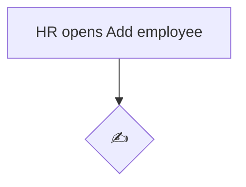
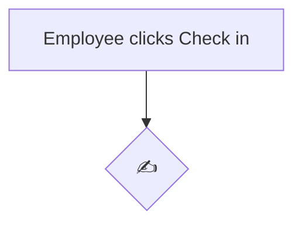
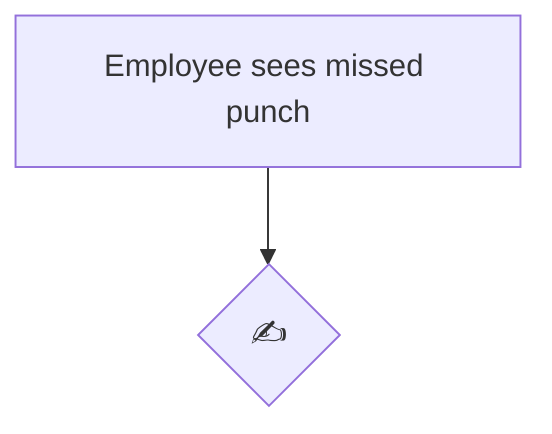

# DESIGN.md — <Your product name>

> **Template — every "✍️" is your design work.** Low-fidelity is fine: ASCII boxes, a photo of a paper
> sketch in `docs/wireframes/`, or an Excalidraw/Figma export. What matters is that every screen
> maps to a table/field in ARCHITECTURE.md.

**Author:** <your name> · **Version:** 1

---

## 1. Product identity
- Name: ✍️ · Why this name: ✍️
- Logo: ✍️ (file in `docs/` or `public/`)

## 2. User flows (flowcharts)

Each flow: start, decision diamonds, every outcome (including errors and rejections), end.

### 2.1 Add employee

### 2.2 Check-in → day status

### 2.3 Apply leave → approval → balance update

### 2.4 Missed punch → regularisation

## 3. Wireframes

For each screen: who sees it, what's on it, the main actions, and the tables/fields it reads/writes.

| Screen | Who | Wireframe | Reads / writes |
|---|---|---|---|
| Home dashboard (check in + balances visible without clicking) | Everyone | ✍️ | ✍️ |
| My profile | Everyone | ✍️ | |
| Employee directory | HR | ✍️ | |
| Add / edit employee (multi-step) | HR | ✍️ | |
| My attendance | Everyone | ✍️ | |
| Team attendance | Managers, HR | ✍️ | |
| Apply leave | Everyone | ✍️ | |
| My leave | Everyone | ✍️ | |
| Approvals inbox | Managers, HR | ✍️ | |
| Leave calendar | Managers, HR | ✍️ | |
| Ask HR (agent) | Everyone | ✍️ | |
| Settings | HR | ✍️ | |
| Reports | Managers, HR | ✍️ | |

### Phone layouts (required)
- Check-in: ✍️
- Apply leave: ✍️
- Ask HR (must work on a phone too): ✍️

## 4. Design system

### Colour palette
| Token | Hex | Use | Contrast ratio vs background (aim ≥ 4.5:1 for text) |
|---|---|---|---|
| primary | ✍️ | | |
| background | ✍️ | | |
| text | ✍️ | | |
| danger | ✍️ | | |

### Status colours — used identically on every screen
| Status | Colour | Text/label | Icon or pattern (so it isn't colour-only) |
|---|---|---|---|
| Present | ✍️ | | |
| Half Day | ✍️ | | |
| Absent | ✍️ | | |
| On Leave | ✍️ | | |
| Holiday | ✍️ | | |
| Weekly Off | ✍️ | | |
| Late | ✍️ | | |

### Typography and spacing
- Font(s): ✍️ · Sizes: ✍️ · Spacing scale: ✍️

### Components
Describe each (states: default, hover, disabled, error):
- Button: ✍️
- Card: ✍️
- Table: ✍️
- Form field with error message: ✍️
- Status badge: ✍️

## 5. Empty, loading and error states

| Screen | Empty | Loading | Error |
|---|---|---|---|
| Dashboard | ✍️ | ✍️ | ✍️ |
| Approvals inbox | ✍️ | ✍️ | ✍️ |
| Reports | ✍️ | ✍️ | ✍️ |
