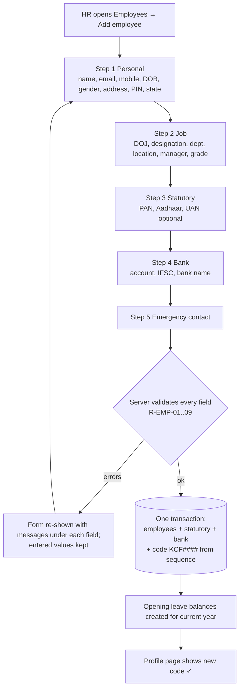
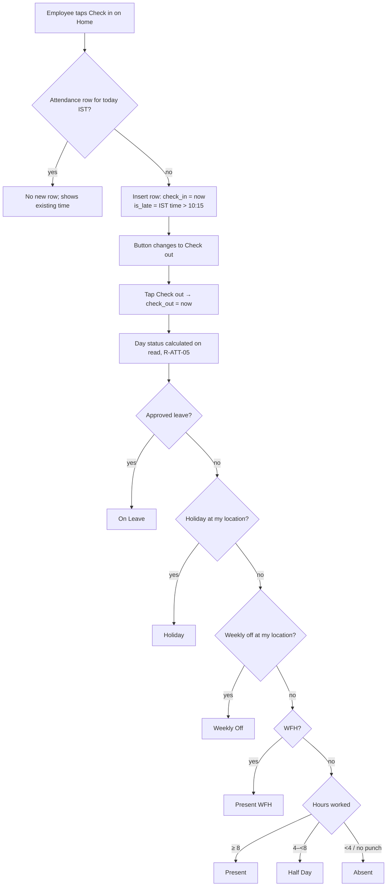
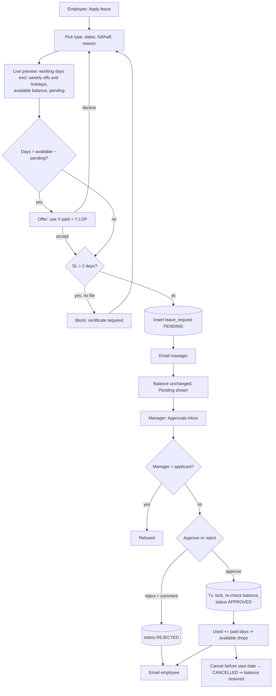

# DESIGN.md: Lehar HR

> "Lehar" (लहर) means *wave*: a nod to the Konkan coast, and the idea of HR that flows instead of
> piling up in Excel, registers and WhatsApp.
> Design goal from the brief: **an employee can check in and see their leave balance without clicking anything else.**

---

## 1. Brand

**Logo:** a rounded-square tile in sea teal, with two white wave lines and a small coral sun
(`public/logo.svg`, also used as the favicon `app/icon.svg`). The wordmark "Lehar HR" is set in the
UI font, semibold, followed by the subtitle "Konkan Coastal Foods".

```
 ╭──────╮
 │  ●   │  Lehar HR
 │ ∿∿∿∿ │  Konkan Coastal Foods
 │ ∿∿∿∿ │
 ╰──────╯
```

## 2. Design tokens

### Colour palette (all text pairs meet WCAG AA, ≥ 4.5:1)

| Token | Hex | Use | Contrast |
|---|---|---|---|
| `--brand` | `#0F766E` | Primary buttons, active nav, links | 5.5:1 on white |
| `--brand-strong` | `#115E59` | Button hover | 7.6:1 on white |
| `--brand-soft` | `#CCFBF1` | Selected rows, chips | n/a (background) |
| `--accent` | `#EA580C` | Logo sun, the one highlight on the dashboard | 3.6:1 (decorative only, never body text) |
| `--ink` | `#0F172A` | Body text | 17:1 on white |
| `--muted` | `#475569` | Secondary text, labels | 7.5:1 on white |
| `--line` | `#E2E8F0` | Borders, dividers | n/a |
| `--surface` | `#F8FAFC` | Page background | n/a |
| `--card` | `#FFFFFF` | Cards | n/a |
| `--danger` | `#B91C1C` | Errors, destructive buttons | 6.5:1 on white |
| `--success` | `#15803D` | Success toasts | 5.0:1 on white |

### Status colours: used identically on every screen

Each status has a **colour, a short code and a label**, so colour is never the only signal
(colour-blind safe). Implemented once in `components/ui/status-badge.tsx` and `lib/core/status.ts`.

| Status | Code | Background | Text | Contrast |
|---|---|---|---|---|
| Present | `P` | `#DCFCE7` | `#166534` | 6.5:1 |
| Present (WFH) | `WFH` | `#DCFCE7` | `#166534` | 6.5:1 |
| Half Day | `HD` | `#FEF3C7` | `#92400E` | 6.4:1 |
| Absent | `A` | `#FEE2E2` | `#991B1B` | 6.8:1 |
| On Leave | `L` | `#DBEAFE` | `#1E40AF` | 7.1:1 |
| Holiday | `HOL` | `#F3E8FF` | `#6B21A8` | 7.4:1 |
| Weekly Off | `WO` | `#F1F5F9` | `#475569` | 6.9:1 |
| Late (tag) | `LATE` | `#FFEDD5` | `#9A3412` | 6.2:1 |
| In progress (today) | `…` | `#CCFBF1` | `#115E59` | 6.9:1 |

Request status badges: **Pending** amber, **Approved** green, **Rejected** red, **Cancelled** slate (same pairs as above).

### Typography
- **Font:** the system UI font (Segoe UI on Windows, San Francisco on Mac, Roboto on Android). No web font is downloaded, so the app also works fully offline. Numbers use `tabular-nums` so balances line up.
- **Scale:** 12 (caption) · 14 (body-sm, tables) · 16 (body) · 20 (h3) · 24 (h2) · 30 (page title, 24 on phones).
- **Weights:** 400 body, 500 labels, 600 headings and numbers on balance cards.

### Spacing, shape, elevation
- 4-px grid: 4 · 8 · 12 · 16 · 24 · 32 · 48.
- Radius: 8 px controls, 12 px cards, 999 px badges.
- Shadow: one level only (`0 1px 2px rgb(15 23 42 / .06)`) on cards.
- Touch targets ≥ 44 × 44 px. The check-in button is 56 px tall on phones.

### Reusable components (`components/ui`)

| Component | States |
|---|---|
| **Button** | primary · secondary · ghost · danger; `disabled`; `loading` (spinner plus "Saving…"; double submit blocked) |
| **Card** | title, optional action slot, body |
| **Table** | sticky header; zebra rows on desktop; becomes stacked cards below 640 px |
| **Field** | label, input, hint, **error** (red border, ⚠ icon, message under the field, `aria-invalid`, `aria-describedby`) |
| **StatusBadge** | the 9 statuses above |
| **RequestBadge** | Pending / Approved / Rejected / Cancelled |
| **EmptyState** | icon, one sentence, optional action |
| **Skeleton** | grey shimmer blocks matching the final layout (loading) |
| **Alert** | info · warning · error, inline in the page (no pop-up modals) |
| **Masked** | shows `ABCDE****F`; HR sees a 👁 Reveal button (PAN and bank only) |

---

## 3. Navigation

Desktop: a fixed left sidebar. Phone: a top bar with the logo and a menu button that opens the sidebar as a drawer.
Menu items appear only for the roles that may use them; **the server still checks every request**.

| Item | Employee | Manager | HR |
|---|---|---|---|
| Home | ✓ | ✓ | ✓ |
| My profile | ✓ | ✓ | ✓ |
| My attendance | ✓ | ✓ | ✓ |
| My leave / Apply | ✓ | ✓ | ✓ |
| Ask HR (agent) | ✓ | ✓ | ✓ |
| Team attendance | | ✓ | ✓ |
| Approvals | | ✓ | ✓ |
| Leave calendar | | ✓ | ✓ |
| Reports | | ✓ | ✓ |
| Employees | | | ✓ |
| Settings | | | ✓ |

---

## 4. User flows

### 4.1 Add employee (HR)


### 4.2 Check-in → day status


### 4.3 Apply leave → approval → balance update


### 4.4 Missed punch → regularisation
```mermaid
flowchart TD
  A[My attendance: a past day shows Absent / missed punch] --> B[Click day → Request correction]
  B --> C[Enter actual in and out times IST + reason]
  C --> D[(regularisation_request PENDING)]
  D --> E[Attendance unchanged]
  E --> F[Manager approvals inbox]
  F --> G{Approve?}
  G -- reject --> H[(REJECTED); day stays Absent]
  G -- approve --> I[(Tx: upsert attendance with corrected times,<br/>source = REGULARISATION, audit entry)]
  I --> J[Day status recalculated: Present or Half Day]
```

---

## 5. Wireframes (low fidelity)

### 5.1 Home dashboard: desktop
```
┌────────────┬─────────────────────────────────────────────────────────────────┐
│ ≋ Lehar HR │ Good morning, Ravi                       Sun 25 Oct 2026 · IST  │
│            ├───────────────────────────────┬─────────────────────────────────┤
│ ▸ Home     │ TODAY · Verna Plant           │ LEAVE BALANCE (2026)             │
│   Profile  │  Status: [… In progress]      │ ┌──────┐┌──────┐┌──────┐┌──────┐ │
│   Attend.  │  In 09:02  Out —              │ │ CL   ││ SL   ││ EL   ││ LOP  │ │
│   Leave    │  ┌─────────────────────────┐  │ │ 6.5  ││ 7    ││ 11.25││ —    │ │
│   Ask HR   │  │      CHECK OUT          │  │ │avail.││avail.││avail.││      │ │
│   ───────  │  └─────────────────────────┘  │ └──────┘└──────┘└──────┘└──────┘ │
│   Team     │  [ Working from home today ]  │ Pending: 1 request (2 days)     │
│   Approvals├───────────────────────────────┴─────────────────────────────────┤
│   Calendar │ MY PENDING REQUESTS               │ TEAM TODAY (managers)       │
│   Reports  │ CL 28–29 Oct · 2 days · Pending   │ ● 9 Present ● 1 Leave ● 2 A │
│   Settings │ Regularisation 21 Oct · Pending   │ Anita – On Leave …          │
└────────────┴─────────────────────────────────────────────────────────────────┘
```

### 5.2 Home dashboard: **phone** (check-in without any other click)
```
┌──────────────────────────┐
│ ≋ Lehar HR           ☰   │
├──────────────────────────┤
│ Hi Ravi · Sun 25 Oct     │
│ Verna Plant · [In prog.] │
│ In 09:02 · Out —         │
│ ┌──────────────────────┐ │
│ │     CHECK OUT        │ │  ← 56 px, full width
│ └──────────────────────┘ │
│ [ Working from home ]    │
├──────────────────────────┤
│ CL 6.5 │ SL 7 │ EL 11.25 │  ← balance strip, no click
├──────────────────────────┤
│ Pending: CL 28–29 Oct    │
│ [ Apply leave ]          │
└──────────────────────────┘
```

### 5.3 Apply leave: **phone**
```
┌──────────────────────────┐
│ ← Apply leave            │
├──────────────────────────┤
│ Leave type   [ CL ▾ ]    │
│ Available 6.5 · Pend. 2  │
│ From  [ 30-10-2026 ]     │
│ To    [ 02-11-2026 ]     │
│ ( ) Full day (•) Half    │  ← disabled unless one date + allowed
│ Reason [______________]  │
│ ┌──────────────────────┐ │
│ │ 2 working days       │ │  ← live preview
│ │ Excludes: Sat 31 WO, │ │
│ │ Sun 1 WO             │ │
│ └──────────────────────┘ │
│ ⚠ Only 1 day left.       │  ← when short
│ [✓] Convert 1 day to LOP │
│ Certificate [Choose file]│  ← only for SL > 2 days
│ ┌──────────────────────┐ │
│ │   SUBMIT REQUEST     │ │
│ └──────────────────────┘ │
└──────────────────────────┘
```

### 5.4 My profile / employee profile (tabs)
```
┌──────────────────────────────────────────────────────────────┐
│ KCF0007 · Ravi Gaonkar · Machine Operator · Verna · Active   │
│ [Personal] [Job] [Statutory] [Bank] [Emergency] [Audit*]     │
├──────────────────────────────────────────────────────────────┤
│ Statutory                                                    │
│ PAN      ABCDE****F         [👁 Reveal]*                      │
│ Aadhaar  XXXX XXXX 4821     (never revealed)                  │
│ UAN      1009****4532                                         │
│                                   * HR only; every Reveal logged │
└──────────────────────────────────────────────────────────────┘
Personal tab: phone, address and emergency contact are editable by the employee; job fields are read-only for them.
```

### 5.5 Employee directory (HR)
```
┌──────────────────────────────────────────────────────────────┐
│ Employees                       [⇩ CSV (masked)] [+ Add]     │
│ [Search name / code] [Dept ▾] [Location ▾] [Active ▾]        │
├────────┬──────────────┬──────────┬────────┬─────────┬────────┤
│ Code   │ Name         │ Dept     │ Loc    │ Manager │ Status │
│ KCF0001│ Vikram Sard..│ HR & Fin │ Panaji │ —       │ Active │
└────────┴──────────────┴──────────┴────────┴─────────┴────────┘
```

### 5.6 Add / edit employee (HR): multi-step
```
 (1 Personal)──(2 Job)──(3 Statutory)──(4 Bank)──(5 Emergency)
 ┌─────────────────────────────────────────────┐
 │ PAN  [ABC123      ]                          │
 │      ⚠ PAN must be 5 letters, 4 digits,      │
 │        1 letter (e.g. ABCDE1234F)            │
 │ [Back]                          [Next →]     │
 └─────────────────────────────────────────────┘
```

### 5.7 My attendance
```
┌──────────────────────────────────────────────────────────────┐
│ ◀ October 2026 ▶          Present 17 · HD 1 · A 1 · L 2      │
│ Mon  Tue  Wed  Thu  Fri  Sat  Sun                            │
│ [P]  [P]  [P]  [P]  [HOL][P]  [WO]    ← Verna: Sat working   │
│ [P·LATE] [HD] [A!] …                  ← click → details/regularise
├──────────────────────────────────────────────────────────────┤
│ My regularisation requests: 21 Oct · 09:00–18:00 · Pending   │
└──────────────────────────────────────────────────────────────┘
```

### 5.8 Team attendance (manager, HR)
```
 Today ▸ [Present 9] [On leave 1] [Absent 2] [Not yet in 1]
 Name            Status       In     Out    Late
 Anita Fernandes [L]          —      —
 Ravi Gaonkar    […]          09:02  —
 Month grid: rows = people, columns = days, cells = status codes
```

### 5.9 My leave
```
 [CL card: Opening 0 · Accrued 8 · Used 1.5 · Pending 2 · Available 6.5] [SL …] [EL …]
 History: Type · Dates · Days (paid / LOP) · Status · [Cancel]
```

### 5.10 Approvals inbox (manager, HR)
```
 [Leave (3)] [Regularisation (1)]
 Ravi Gaonkar · CL · 30 Oct–2 Nov · 2 days · Balance 6.5 → 4.5
 ⚠ Clash: Anita on leave 30 Oct
 Comment [__________]  [Approve] [Reject]
```

### 5.11 Leave calendar (manager, HR)
```
 ◀ November 2026 ▶   Rows = team members, columns = days
 Anita  ·  ·  [CL][CL] ·  …
 Ravi   ·  ·  [CL] ·  ·    ← two people same day = clash highlighted
```

### 5.12 Ask HR (agent)
```
┌──────────────────────────┐
│ Ask HR                   │
│ You: kal ki chutti       │
│ chahiye, kitni CL bachi? │
│ HR: Aapke paas 6.5 CL    │
│ hain. Kal (Mon 26 Oct)   │
│ 1 working day hai. Draft │
│ ready:                   │
│ ┌──────────────────────┐ │
│ │ CL · 26 Oct · 1 day  │ │
│ │ [Confirm] [Discard]  │ │
│ └──────────────────────┘ │
│ ▸ Tools used: get_my_    │
│   leave_balance, count_  │
│   working_days, draft_.. │
│ [Type a question…] [➤]   │
└──────────────────────────┘
```

### 5.13 Settings (HR)
```
 [Locations] [Departments] [Holidays] [Leave types] [Policy text]
 Holidays: Year [2026] Location [Both ▾]  + Add (date, name, type National/State/Optional)
 Leave types: code, name, quota, accrual, carry fwd max, half-day allowed ✓
```

### 5.14 Reports (manager: own team, HR: all)
```
 Month [Oct 2026 ▾]   [⇩ Download CSV]
 Code · Name · Present · WFH · CL · SL · EL · ML · PL · LOP · Holidays · Weekly offs · Late
```

---

## 6. Empty, loading and error states

| Screen | Empty | Loading | Error |
|---|---|---|---|
| **Dashboard** | "No pending requests 🎉" in the requests card; "Your team is all in" when there are no absentees | Skeleton cards in the same grid (`loading.tsx`) | Inline red alert "Couldn't load today's attendance. Refresh to try again." The check-in button stays usable |
| **Approvals inbox** | "Nothing waiting for you. New requests will appear here." | Skeleton rows | Approve/Reject errors (e.g. "Balance changed: only 1 day available now") shown on that row; nothing else changes |
| **Reports** | "No employees in scope for this month" | "Calculating…" skeleton table | "Month must be within employment period" or a generic retry message |
| **Ask HR** | Suggested prompts: "How many CL do I have?", "Holidays this month?" | Typing dots + "Checking…" | "The assistant is busy (free-tier limit). Try again in a minute." |
| **Forms** | n/a | Button shows a spinner + "Saving…" and is disabled | Field-level messages + a summary alert at the top |
| **404 / denied** | n/a | n/a | "Page not found" (also for another employee's profile); `/access-denied` for exited or unknown users |
